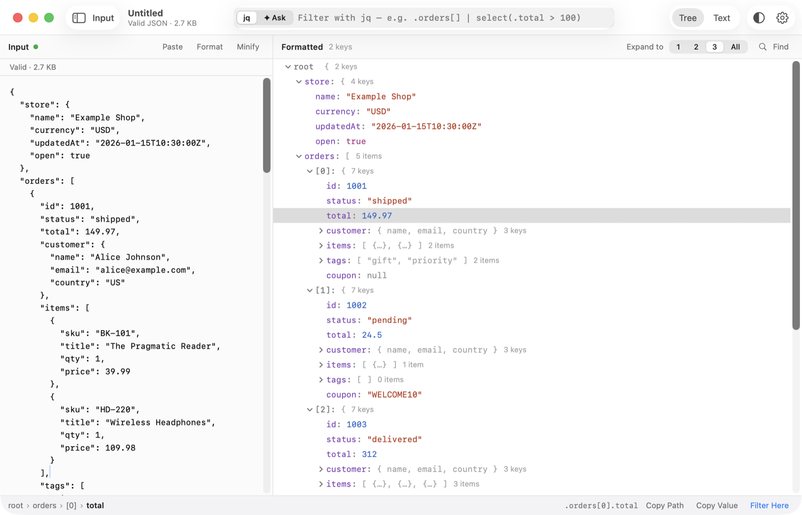
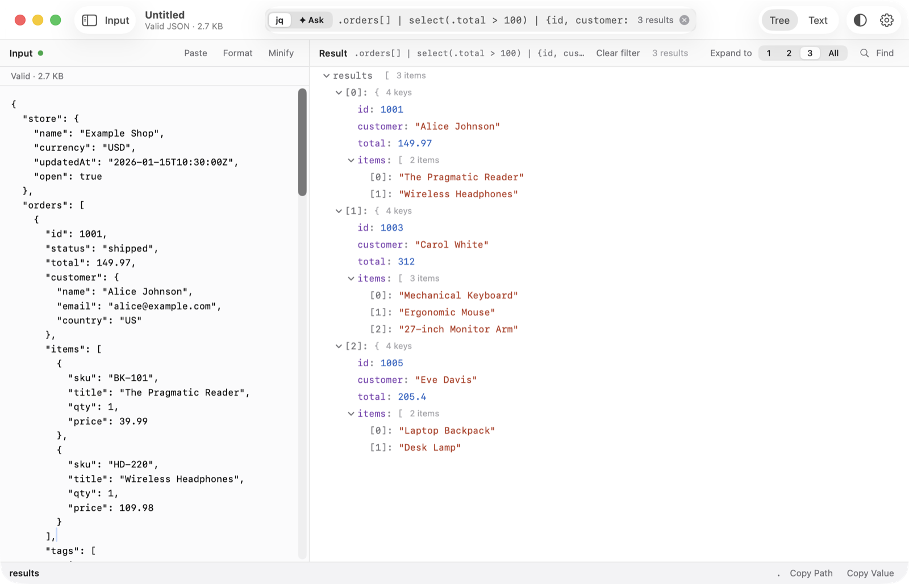
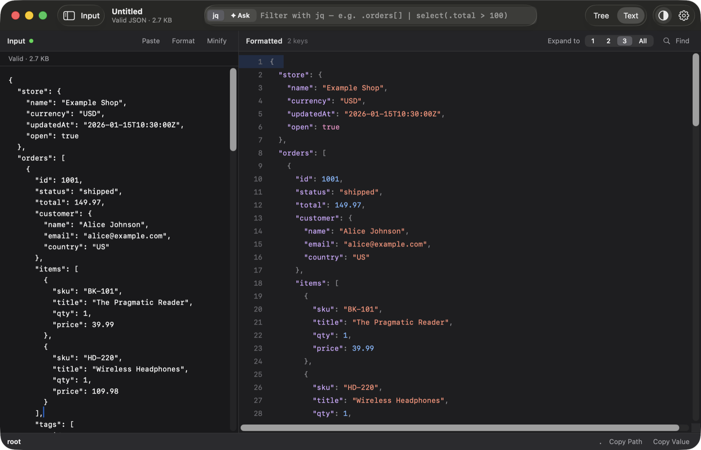

# JSON Viewer

A fast, native macOS app for reading JSON. Paste a document and it is formatted instantly as a collapsible tree or syntax-highlighted text. You can then slice it with jq, or describe what you want in plain English and let an AI provider write the jq for you.



## Features

- **Paste anywhere**: press ⌘V anywhere in the window and the input is replaced and parsed. Invalid JSON shows the line, column and reason.
- **Tree and Text views**: collapsible tree with key/item counts, or line-numbered pretty-printed text. Expand to depth 1–3 or all (⌘1–⌘4).
- **jq filters (⌘L)**: jq 1.8 is bundled inside the app, so nothing needs to be installed.
- **Ask in plain English (⌘K)**: an AI provider (OpenAI, Anthropic or OpenRouter) turns your question into a jq filter. You can review it with "Edit as jq". API keys are stored in the macOS Keychain.
- **Find (⌘F)**: searches keys and values, with ⌘G / ⇧⌘G to step through matches.
- **Path tools**: select any node to see its breadcrumb and jq path, then use Copy Path, Copy Value or Filter Here.
- **Format / Minify** the input, adjustable font size (⌘+ / ⌘−), and light, dark or system appearance.





## Requirements

- macOS 14 (Sonoma) or later, Apple silicon or Intel.
- Xcode **or** just the Command Line Tools (`xcode-select --install`). The app builds with plain `swiftc`, so you don't need an Xcode project or SwiftPM.
- Internet access on the first build only, to download the official jq release binary (checksum-verified and cached in `build/`).

## Build

```sh
git clone https://github.com/rohithb/json-viewer.git
cd json-viewer
./build.sh
```

This produces `build/JSON Viewer.app` for your Mac's architecture. Run it with:

```sh
open "build/JSON Viewer.app"
```

To build a universal (arm64 + x86_64) release with hardened runtime, plus a disk image:

```sh
./build.sh release      # → dist/JSON-Viewer-<version>.dmg
```

## Install

**From a local build:** copy the app into Applications:

```sh
cp -R "build/JSON Viewer.app" /Applications/
```

**From the DMG:** open `dist/JSON-Viewer-<version>.dmg` and drag **JSON Viewer** onto **Applications**.

The app is ad-hoc signed, not notarized. A copy you built yourself opens normally. If you got the DMG from someone else, Gatekeeper will block the first launch. Right-click the app and choose **Open**, or clear the quarantine flag:

```sh
xattr -dr com.apple.quarantine "/Applications/JSON Viewer.app"
```

### Optional: stable code-signing identity

Ad-hoc signatures change on every build, so macOS asks for Keychain access again for each saved API key after you rebuild. To avoid this, create a self-signed code-signing certificate named **`JSON Viewer Dev`** in Keychain Access (Certificate Assistant → Create a Certificate → type *Code Signing*). `build.sh` uses it automatically when present.

## Usage

1. Launch the app and press ⌘V, or click **Load Sample**.
2. Type a jq filter in the toolbar (⌘L), e.g. `.orders[] | select(.total > 100)`, and press Return.
3. To use **Ask** (⌘K), add an API key under **Settings → AI Providers** and click **Verify Key**.

## Development

- Sources live in `Sources/JSONViewer/`. `build.sh` compiles them all with `swiftc`.
- Regenerate the app icon: see `scripts/make-icon.swift`.

## License

[MIT](LICENSE)
